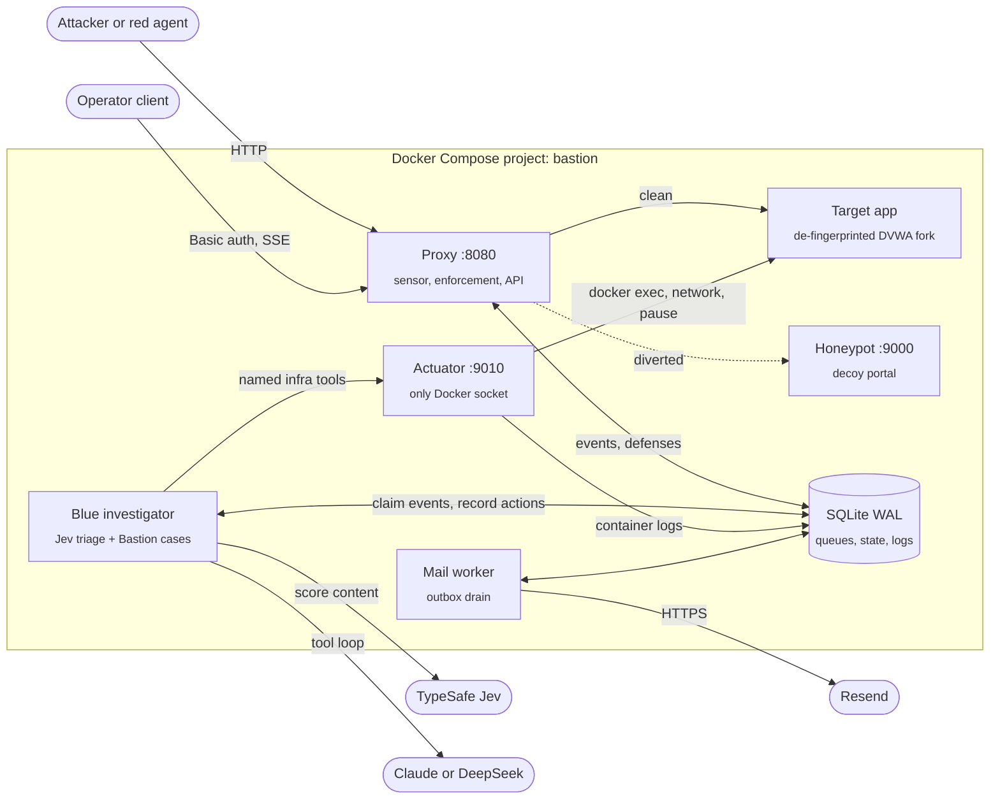
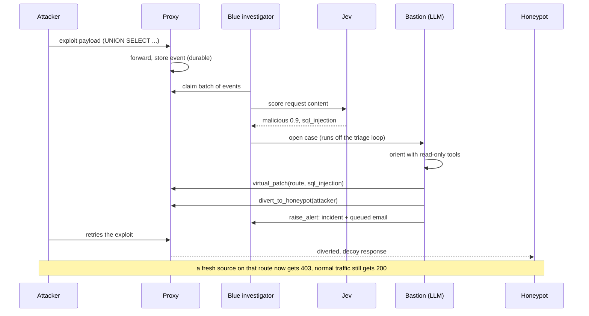

# Bastion

**An autonomous blue-team agent that watches a web app's traffic and contains attacks on its own.**

Bastion sits in front of a service as a reverse proxy. Every request is logged and scored by **Jev**, a fast classifier. Anything Jev flags goes to **Bastion**, an LLM investigator that looks around with read-only tools and then acts: it diverts the attacker to a honeypot, bans the source, installs a virtual patch on the exploited route, hardens the app, and files an incident with an email alert. The loop runs with no human in it, and an authenticated API exposes each step as it happens.

The repo ships a complete local lab: the proxy, the investigator, a privileged actuator, a honeypot, a mail worker, a deliberately vulnerable target app, and a red-team agent that attacks it.

**Status:** experimental. The target app is intentionally exploitable. Run the lab on a trusted machine and never expose it to the internet.

## What it does

- **Two-tier triage.** Jev (TypeSafe system-1 classifier) scores request content in parallel batches; only flagged requests reach the LLM (Claude or DeepSeek). A flag is a reason to look, not proof.
- **Contain, patch, eradicate, alert.** Bastion can divert or ban a source, install a route-scoped virtual patch from a vetted pattern set, raise the app's security level, kill sessions or processes, cut egress, quarantine the container and rotate credentials. On a confirmed exploit it is instructed to both contain the source and patch the route, and a backstop diverts any malicious source still uncontained once a patch lands.
- **Receipts for every action.** Each tool call is schema-validated, recorded with its case id, tier (reflex, Bastion or operator) and reason, and executed at most once.
- **Durable by default.** Requests, triage, actions, incidents, the email outbox and container logs live in SQLite (WAL). Work survives restarts.
- **Operator API.** Authenticated endpoints under `/__api/v1` serve the detection funnel, requests, incidents, defenses and container logs as JSON and SSE, plus controls to launch a red-team run, stop it and reset the lab. The web frontend is being rebuilt on this branch.
- **A target models cannot memorize.** The vulnerable app is a de-fingerprinted fork of DVWA's modules, re-seeded on every boot, so the red agent has to probe and fail before it succeeds. That gives the blue side real signal to act on.

## Architecture



The proxy applies these rules, in order, to every request, reading shared state that Bastion controls:

1. **Divert** a source on the honeypot list to the decoy. This takes precedence over everything else.
2. **Deny** a source with an active ban: `403`.
3. **Virtual patch**: if the decoded query or body matches a patch installed for that route, `403` for every source.
4. **Rate limit** per source (sliding window, default 100 requests per 10 s): `429`.
5. **Inline classify** (only in `inline` mode): a malicious Jev verdict returns `403`.
6. **Forward** to the target app and record the response.

One incident, end to end:



Hard limits and guarantees:

- **Case budget:** 8 model turns, 16 tool calls, 60 s and 24k tokens per case. Model calls are also capped per minute (`MODEL_CALLS_PER_MINUTE`, default 120) in the shared store.
- **Triage never waits on a case.** Jev scores each claimed batch (up to 32 events, 8 at a time) while investigations run one at a time in a separate lane; cases flagged meanwhile are grouped into the next one.
- **Exactly-once actions.** Every mutating tool call carries an execution key (case, tool, arguments). A retry after a crash returns the recorded result, or `UNKNOWN` for an interrupted attempt, instead of firing twice.
- **Guarded authority.** Bans and diversions need a malicious Jev verdict for that exact source within the last hour. Infrastructure tools (kill, egress, quarantine, credential rotation, security level) need `ALLOW_DESTRUCTIVE=1`; compose defaults it to `0`. Only the actuator mounts the Docker socket, and it authenticates every call with `ACTUATOR_TOKEN`.
- **Reset is clean.** A case whose requests were wiped by a lab reset is dropped, so it cannot leave stale defenses on the fresh board.
- **Network split.** The target reaches the proxy over an internal `edge` network and the outside world only over `egress`, which `isolate_egress` can cut without breaking the proxy path.

See [architecture.md](architecture.md) for component responsibilities, queue states and persistence details.

## Getting started

### Requirements

- Docker with Docker Compose
- A TypeSafe API key (Jev)
- An Anthropic or DeepSeek API key for `agent` mode and for the red agent
- Optional: a Resend API key and a verified sending domain for email alerts
- Python 3.12+ only if you run tests outside Docker

### Windows, one command

```bat
scripts\start-demo.cmd
```

On first run this creates `.env` from `.env.example` with fresh management and actuator tokens and `BASTION_MODE=agent`, opens it in Notepad if keys are missing, builds and starts the stack and copies the management token to your clipboard. Add `-Attack` to also run a time-boxed red-team attack (25 s by default, `-Seconds 40` to change it), or `-Stop` to shut the stack down.

### Any platform

```sh
git clone https://github.com/adamhjouj/bastion.git
cd bastion
cp .env.example .env
python3 -c 'import secrets; print(secrets.token_hex(32)); print(secrets.token_hex(32))'
```

Put one generated value in each token and fill in your keys:

```env
MANAGEMENT_TOKEN=first-generated-token
ACTUATOR_TOKEN=second-generated-token
BASTION_MODE=agent
TYPESAFE_API_KEY=your-typesafe-key
DEEPSEEK_API_KEY=your-deepseek-key      # or ANTHROPIC_API_KEY; DeepSeek wins if both are set
RESEND_API_KEY=your-resend-key          # optional
ALERT_FROM="Bastion Alerts <alerts@your-domain.com>"
ALERT_TO=you@example.com
```

Then start it:

```sh
bash run.sh                 # checks the tokens, then docker compose up --build -d
```

- **API:** http://localhost:8080/__api/v1/overview, username `admin`, password `MANAGEMENT_TOKEN`
- **Target app:** http://localhost:8080/ (browse it and your clicks show up as live requests)

The target initializes its own database at boot; there is no setup step. Keep `.env` private. [`.env.example`](.env.example) documents the remaining settings: classifier threshold and timeout, request limits, source attribution, retention and the target seed.

### Run a demo

`POST /__api/v1/control/run` with `{"job": "attack-sqli"}` (or `attack-cmdi`, `attack-lfi`, `attack-xss`) launches the red agent with that objective, `/__api/v1/control/stop` ends the run, and `/__api/v1/control/reset` puts the lab back to a clean, exploitable state. Runs call your LLM provider, so keep them short.

Reset restores the target (unpause, reconnect egress, security level back to `medium`) and clears requests, incidents, logs, bans, diversions and virtual patches. To clear only the defenses and keep the history, run `python reset_demo.py` from the host.

```sh
docker compose logs -f proxy blue mail-worker   # follow the backend
docker compose down                             # stop; add --volumes to delete stored data
```

## Operating modes

`BASTION_MODE` decides when classification happens and who acts on it. The compose default is `observe`.

| Mode | Behavior | Keys needed |
| --- | --- | --- |
| `observe` | Capture traffic only. Existing bans, diversions, patches and rate limits still apply. | None |
| `agent` | Jev scores requests after capture; flagged ones go to Bastion, which decides the response. Without Jev, eligible requests go straight to the LLM. | LLM; Jev recommended |
| `classifier-contain` | Jev scores requests after capture; a malicious verdict triggers a provisional 15-minute ban and an incident. | TypeSafe |
| `inline` | Jev scores before forwarding and malicious requests get `403`; flagged cases can still go to Bastion. | TypeSafe; LLM optional |

Asynchronous modes cannot stop the first request from reaching the app; they stop what comes next. Inline mode adds Jev's latency to every request. With `INLINE_FAILURE=reject` (the default) a classifier failure returns `503`; `allow` forwards the request.

## Operator API

The web frontend was removed on this branch to be rebuilt from scratch. The backend it used is intact:

- **Read:** `/__api/v1/overview` (funnel, outcomes, recent events, actions, incidents and active defenses), `/__api/v1/stream` (the same snapshot over SSE), paginated records such as `/__api/v1/requests`, `/__api/v1/incidents/<id>`, and container logs at `/__api/v1/logs/<source>` with cursors and an SSE stream.
- **Control:** `/__api/v1/control/status`, `/run`, `/stop` and `/reset`.
- **Auth:** HTTP Basic (`admin` and `MANAGEMENT_TOKEN`) or a Bearer token. Every `/__` route is sent with `Cache-Control: no-store` and a strict CSP (`default-src 'self'`, no inline script or style).

## Response toolkit

| Kind | Tools | Notes |
| --- | --- | --- |
| Look around | `recent_requests`, `recent_incidents`, `get_defenses`, `service_status`, `inspect_target`, `list_processes`, `list_sessions` | Read-only; logged with their results omitted |
| Contain a source | `divert_to_honeypot`, `blacklist_ip`, `bulk_blacklist_ip` | Needs a malicious verdict for that source; reflex bans are provisional and expire |
| Contain the host | `isolate_egress`, `quarantine_container`, `kill_session`, `kill_process` | Needs `ALLOW_DESTRUCTIVE=1` |
| Patch and eradicate | `virtual_patch`, `patch_vuln`, `rotate_secret` | Virtual patches use vetted patterns for SQL injection, command injection, path traversal and XSS; the other two need `ALLOW_DESTRUCTIVE=1` |
| Undo | `unban_ip`, `undivert`, `reconnect_egress`, `release_container` | The last two need `ALLOW_DESTRUCTIVE=1` |
| Alert | `raise_alert` | Writes the incident and queues the email in one transaction |

Process termination needs Linux pidfd support in the target, and egress isolation relies on the separate `egress` network in the compose file.

## The lab target and red team

The target (`target_app/`) keeps the vulnerable code from DVWA's SQL injection, command injection, file viewer and reflected XSS modules, but every recognizable fingerprint is mutated per boot: page paths, parameter names, cookie and table names, response templates, credentials, and a SQLite backend in place of MySQL. Set `BASTION_SEED` to pin one instance. [MUTATION.md](MUTATION.md) has the full scheme.

`red_agent.py` is a scoped LLM attacker with four objectives: `sqli` (dump the credential store), `cmdi` (remote command execution), `lfi` (read a file outside the viewer) and `xss` (reflected script injection). Launch it through the control API, with `docker compose --profile red-team up red`, or from the host:

```sh
python red_agent.py sqli    # or cmdi, lfi, xss
```

## Email alerts

Alerts go out through Resend's HTTPS API. The `mail-worker` service drains the durable outbox independently of investigations, retries transient failures (up to five attempts, stable idempotency key) and records provider acceptance ids. Send one labeled test email without generating traffic:

```sh
docker compose run --rm --no-deps mail-worker python mail_worker.py --test
```

`accepted` means Resend accepted the message; delivery and bounce status live in Resend's email log.

## Development

```sh
uv venv --python 3.12
uv pip install -r requirements.txt pytest
.venv/bin/python -m pytest -q
```

Opt-in Docker tests start isolated fixture containers:

```sh
RUN_DOCKER_TESTS=1 .venv/bin/python -m pytest -q test_docker_logs.py
RUN_DOCKER_APP_TESTS=1 .venv/bin/python -m pytest -q test_docker_dashboard.py
```

The default suites use mock transports and cover proxy enforcement, classifier failures, tool dispatch and idempotency, triage concurrency, queues, reset behavior, redaction, auth, notification retries, log replay and the operator API. They do not measure model judgment.

`eval_waf.py` scores Jev on the labeled dataset in `eval_dataset.jsonl` and reports precision and recall with Wilson intervals (live runs use API credit):

```sh
TYPESAFE_API_KEY=your-key .venv/bin/python eval_waf.py --repeat 3
```

`benign_agent.py` simulates ordinary staff. Because the target re-randomizes on every boot, it learns the running instance by browsing it: it reads the operator handbook, signs in, follows the links to the four tools and uses them with normal input (a record number, a loopback host, a published document, a staff name). `eval_live.py` runs that traffic before, during and after an attack and reports Jev's per-phase confusion matrix:

```sh
python benign_agent.py --duration 60
.venv/bin/python eval_live.py --before 20 --during 40 --after 20
```

## Limits

The proxy is a single buffered worker with process-local rate limits. The honeypot shares the lab network and data volume. Infrastructure remediation is specific to the bundled target. Redaction reduces, but does not guarantee removal of, secrets in free text. Request content reaches external model providers, and treating it as untrusted evidence in the prompt is a precaution, not a complete defense against prompt injection. Review all of this before pointing Bastion at anything real.

Built with Python, FastAPI, HTTPX, SQLite, the Anthropic SDK, TypeSafe Jev and Resend.
